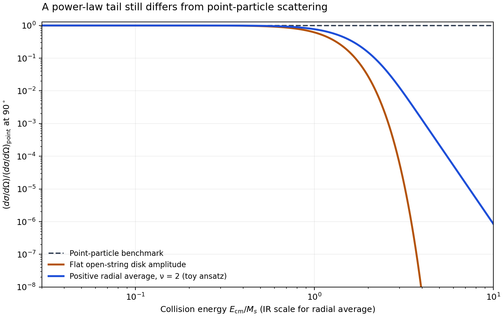

# Can a mesonic open string have a pointlike fermionic state?

Follow-up: [Dual QCD and CP² × S¹](dual_qcd_cp2_s1.md) broadens the construction beyond flat Ramond strings and uses vectorlike Dirac endpoint quarks, as clarified by the user. The flat-string constraints below apply to their stated model, not to every such dual or geometric extension.

The proposal is possible in a **restricted low-energy sense**: an open superstring has bosonic and fermionic states with common endpoint labels, and some tree-level fermion amplitudes agree with point-particle amplitudes up to corrections of order \(E^4/M_s^4\). This does **not** establish a fermion that remains pointlike far above a hadronic string scale while its bosonic partner is a physical QCD meson.

Three separate questions have to be answered: what the endpoints are, what supplies the whole state's fermion parity, and what sets the scale at which its scattering departs from the point-particle result. The two uploaded discussions make progress on the third question, but repeatedly move between different answers to the first two.

I interpret “the fermionic part” as a fermionic state of the complete open string, rather than a hard probe scattering from one of the quarks inside an ordinary meson. The latter already occurs in QCD.

## 1. Physical endpoint quarks and Chan–Paton labels are different constructions

For an ordinary QCD meson, a useful gauge-invariant interpolating operator is

\[
\mathcal O_B^{ij}(x,y)
=\bar q_j(y)\,W(y,x)\,\Gamma q_i(x),
\qquad
W(y,x)=\mathcal P\exp\!\left(ig_s\int_x^y A_\mu\,dx^\mu\right).
\]

The Wilson line is bosonic; the operator contains two fermionic fields. It is therefore even under fermion parity. Changing the path, exciting gluons, or adding quark–antiquark sea pairs does not change that conclusion. Coupling two spin-one-half constituents and integer orbital/gluonic angular momentum gives integer total spin.

**A quark–antiquark pair plus the ordinary QCD flux tube is in the bosonic sector.** It has no fermionic partner merely because the flux tube is described with string variables. Fermionic worldsheet variables do not, by themselves, prove the existence of an additional physical spacetime fermion in QCD.

In the ordinary color-singlet QCD hadron sector with three colors, the same statement can be expressed as

\[
(-1)^F=(-1)^{N_q+N_{\bar q}}
=(-1)^{3B}=(-1)^B.
\]

The equality concerns QCD constituents and integer hadronic baryon number. Thus ordinary mesons, including gluonic hybrids, have even fermion parity. It is not a statement about all possible theories with new fields or new topological sectors.

By contrast, a fundamental open string can have a Chan–Paton matrix \(\lambda^i{}_j\) and a Ramond spinor state \(|i,\bar j;R\rangle\). The labels specify internal quantum numbers; they are not two dynamical quark spinors that have been bound together. The worldsheet construction supplies the spacetime spinor. This is consistent, but **identifying those labels with the constituents of a QCD meson is an additional dynamical claim**.

The color and electric charges also separate the two branches of the original discussion:

\[
3_c\otimes\bar3_c=1_c\oplus8_c,
\qquad
\bar3_c\otimes\bar3_c=3_c\oplus\bar6_c.
\]

The quark–antiquark branch can have a color-singlet, integer-charged, lepton-like Ramond state if suitable additional structure exists. It does not have the fundamental color representation of a quark. The two-antiquark branch can match quark color and some electric charges, but needs the extra baryon number discussed in the uploads: \(-2/3+1=1/3\). These are distinct proposals, not two descriptions of the same endpoint pair.

For the lepton–meson branch, QCD endpoints have lepton number zero. A lepton interpretation must additionally explain lepton number, chirality, and the full electroweak representation. Matching electric charge or counting endpoint labels is insufficient.

## 2. What would make a quark–antiquark string fermionic?

One can add a genuine odd degree of freedom. Schematically,

\[
\mathcal O_F\sim\mathcal O_B\,\chi
\]

is fermionic if \(\chi\) is a spinor. With appropriate quantum numbers it could also supply lepton number. An adjoint fermion gives another schematic possibility,

\[
\bar q(y)W(y,z)\lambda(z)W(z,x)q(x),
\]

with spinor indices coupled to leave a spin-one-half operator. A gluino-containing hadron is an example of this kind of extension. These operators demonstrate how the parity problem can be solved; they do not demonstrate binding, a light mass, or pointlike scattering. If their constituents are resolved in hard scattering, they are composite states.

Supersymmetric gauge theories also have fermionic mesonic composites involving a quark and a squark. For example, in supersymmetric QCD the chiral meson superfield \(\widetilde Q Q\) contains a scalar made of two squarks and a fermion made of quark–squark combinations. It is not an ordinary QCD quark–antiquark meson with an unchanged flux tube. This is a useful reminder that there is no universal prohibition on fermionic mesonic quantum numbers once the field content changes.

A topological or duality construction is another possibility, but then it must specify the new sector and its fermion parity. Calling a Wilson line “Ramond” is not that specification.

## 3. What the open-string scattering calculation actually establishes

For the simple massless open-superstring sector used in the uploaded discussions, an ordered disk amplitude is

\[
A_{\rm string}(a,b)=A_{\rm field}(a,b)\,
V(a,b),\qquad
V(a,b)=\frac{\Gamma(1-\alpha'a)\Gamma(1-\alpha'b)}
{\Gamma(1-\alpha'(a+b))}.
\]

Here \(M_s=1/\sqrt{\alpha'}\). Recovering a QED-like charged fermion requires a suitable embedding and projection; an abelian gaugino is neutral. The Cullen–Perelstein–Peskin construction cited in the uploads is the relevant precedent [S1]. The same-brane oscillator result is not a universal expression for every chiral or intersecting-brane fermion [S2].

In the specified same-sign charged channel, alternating Chan–Paton orderings give

\[
\mathcal M_{RR\to RR}=V(t,u)\,\mathcal M_{\rm point},
\quad
s+t+u=0,\quad t,u<0.
\]

The directly checked expansion is

\[
V(t,u)=1-\zeta(2)\alpha'^2tu
+\zeta(3)\alpha'^3stu+O(\alpha'^4).
\]

For \(t=-s(1-\cos\theta)/2\),

\[
\frac{d\sigma_{\rm string}/d\Omega}{d\sigma_{\rm point}/d\Omega}
=1-\frac{\pi^2}{12}\left(\frac{E_{\rm cm}}{M_s}\right)^4
\sin^2\theta+O\!\left((E_{\rm cm}/M_s)^6\right).
\]

This is the valid part of the original idea: **the first correction in this amplitude is dimension eight, rather than dimension six.** It is an on-shell scattering statement, not a model-independent measurement of a charge radius.

However, the same universal disk factor multiplies the corresponding massless NS amplitudes in this simple sector. The spin-dependent field-theory numerators differ; the string scale and its correction do not disappear selectively for Ramond states. At low energy both sectors have a field-theory limit. At high energy both have string effects.

In the uncompactified GSO-projected open superstring the massless NS state is a vector, not a pion. Four-dimensional scalars can arise from internal components or other compactification sectors. Showing that one is the QCD pion requires its chiral symmetry realization, couplings, and form factors, not just its spin and charge.

### A hadronic scale makes the limitation numerical

At \(90^\circ\), let \(z=\alpha's\). Then

\[
V_{90}(z)=\frac{\Gamma(1+z/2)^2}{\Gamma(1+z)},
\qquad
|V_{90}(z)|^2\sim\frac{\pi z}{2}\,4^{-z}.
\]

With the illustrative hadronic Regge slope \(\alpha'_{\rm had}=0.9\,\mathrm{GeV}^{-2}\), \(M_s=1.054\,\mathrm{GeV}\). Direct evaluation gives:

| Collision energy | \(z\) | Cross-section ratio \(|V_{90}|^2\) |
| --- | ---: | ---: |
| 0.1 GeV | 0.009 | 0.999934 |
| 0.3 GeV | 0.081 | 0.994917 |
| 1 GeV | 0.9 | 0.665169 |
| 3 GeV | 8.1 | \(1.79746\times10^{-4}\) |
| 10 GeV | 90 | \(9.27632\times10^{-53}\) |

This rules out **using this weakly coupled flat-string benchmark with a hadronic slope as a pointlike lepton model over high energies**. It is not a calculation of the actual QCD flux tube's scattering, and not a general exclusion of every strongly coupled string dual. Applying this one color structure to a complete dijet distribution would also require the other subprocesses and their color sums.

The exact same-sign benchmark requires \(M_s/E_{\rm cm}>2.948\) for a deviation below 1% at \(90^\circ\); the leading-order estimate is 3.011. These are sensitivity calculations, not experimental bounds. A cited historical LEP string bound is discussed separately in [sources.md](sources.md); no new experimental fit was performed here.

There is no physical Regge pole in this same-sign channel, where both arguments of \(V\) are spacelike. Allowed crossed channels can contain the tower. Moving a pole out of one physical channel does not eliminate the string from the theory.

## 4. Warping changes the obstruction, but is not yet the requested solution

The Polchinski–Strassler mechanism [S3, S4] allows hard scattering to sample a region with a higher local string scale than the region setting hadronic Regge trajectories. It replaces the flat-string exponential softness by power behavior in its domain of applicability. Therefore the statement “one microscopic string tension always implies one observable hard scale” is too strong.

But **power-law scattering and elementary-fermion scattering are different claims**. For leading hard exclusive constituent counting, ignoring running and helicity qualifications,

\[
\frac{d\sigma}{dt}\sim s^{2-n},
\]

where \(n\) counts the active elementary constituents of all four external states. Four elementary fermions have \(n=4\), giving \(s^{-2}\). Four two-parton composites have \(n=8\), giving \(s^{-6}\). A fermionic composite with an additional resolved carrier must count that carrier too. Chan–Paton indices are not constituents to which this rule may simply be applied.

The first uploaded conversation proposes the positive radial ansatz

\[
\mathcal V_\nu(z,x)=\nu\int_0^1du\,u^{\nu-1}V(zu,x),
\quad \nu>0,\quad x=\frac{1-\cos\theta}{2},
\]

where

\[
V(w,x)=\frac{\Gamma(1+wx)\Gamma(1+w(1-x))}{\Gamma(1+w)}.
\]

This is its hard-wall weight after changing variables \(u=y^2\). As mathematics, the ansatz gives

\[
\mathcal V_\nu
=1-\zeta(2)x(1-x)\frac{\nu}{\nu+2}z^2+O(z^3),
\]

and at large \(z\),

\[
\mathcal V_\nu\sim\nu z^{-\nu}\mathcal M_\nu(x),
\quad
\mathcal M_\nu(x)=\int_0^\infty dw\,w^{\nu-1}V(w,x).
\]

I independently checked the integral and its disk-modulus representation for \(\nu=2,x=1/2\). They give \(\mathcal M_2(1/2)=4.64412305369104\), and hence

\[
|\mathcal V_2(90,1/2)|^2=1.3149141\times10^{-6}.
\]

This reproduces the earlier transcript's numerical example: much harder than the flat result, still very far from the point-particle ratio of one.

**What has not been derived:** the physical four-dimensional spinor modes, their normalization, all exchange diagrams, the measure for the actual background, and a consistent meson/lepton spectrum. In particular, a local radial convolution is not automatically the full amplitude with massless gauge exchange. The radial ansatz is useful for testing an idea, but agreement of its integrals cannot substitute for those ingredients.

Taking \(\nu\to0^+\) concentrates the normalized weight at \(u=0\), where the effective slope vanishes and the local hard scale diverges. This explains why it tends toward pointlike behavior. It does not show that a physical pion and its fermionic partner have those different radial profiles. Likewise, a spinor CFT unitarity bound applies to appropriate gauge-invariant local operators; it cannot directly prove a no-go for a gauge-dependent colored quark field. The earlier discussion overstates that step.

### A useful conditional bound on the hadronic contribution

The positive-average idea gives a simple quantitative target without assigning an unjustified twist to a state. Suppose at fixed energy and angle

\[
\frac{\mathcal A_F}{\mathcal A_{\rm point}}
=\int_0^\infty da\,\rho_F(a)V(as,x),
\quad \rho_F(a)\ge0,\quad \int da\,\rho_F(a)=1,
\]

where \(a\) is a local effective Regge slope. Define

\[
f_{\rm had}=\int_{\alpha'_{\rm had}}^\infty da\,\rho_F(a).
\]

In this spacelike channel, \(V\) decreases from one to zero with increasing slope. Thus

\[
\frac{\mathcal A_F}{\mathcal A_{\rm point}}
\le 1-f_{\rm had}\bigl[1-V(\alpha'_{\rm had}s,x)\bigr].
\]

Requiring a cross-section ratio at least \(1-\epsilon\) gives the necessary condition

\[
f_{\rm had}\le
\frac{1-\sqrt{1-\epsilon}}
{1-V(\alpha'_{\rm had}s,x)}.
\]

At 10 GeV and \(90^\circ\), the denominator is essentially one. Agreement at 1% therefore requires \(f_{\rm had}<0.005013\): less than about **0.5% of this amplitude weight** can come from slopes at least as large as the hadronic one. At 0.1% the bound is about 0.05%.

This is a bound within a positive, factorized amplitude ansatz, not a universal limit on a Fock-space probability or a result for amplitudes with arbitrary interfering terms. It states concretely what a proposed localization mechanism would need to achieve. Giving the fermion such a UV-dominated coupling while the meson remains IR-dominated is additional model building, not a consequence of choosing the Ramond sector.

NS and R sectors are not automatically an unbroken four-dimensional supersymmetry multiplet in every background. If unbroken spacetime supersymmetry does relate the proposed states, their masses and couplings obey supersymmetry Ward identities; independent profiles cannot simply be assigned without checking those identities. If symmetry breaking produces the desired separation, its effects on the scattering operators must be calculated again. The special absence of a dimension-six term cannot be carried over by assumption.

## 5. Massless endpoints do not remove these issues

The final exchanges correctly distinguish current quark masses, dressed propagator masses, effective endpoint masses, and whole-hadron masses. A long-string endpoint action can use a small or vanishing mass parameter while the hadron has a nonzero confinement scale [S5]. A massless endpoint limit does not send \(\alpha'\) to zero or remove the oscillator tower.

The pion also remains a Goldstone boson in the QCD chiral limit even though quarks are dynamically dressed. At small explicit masses,

\[
m_\pi^2=B_0(m_u+m_d)+\cdots.
\]

Its charge form factor, with \(Q^2\ge0\) spacelike, is

\[
F_\pi(-Q^2)=1-\frac16\langle r_\pi^2\rangle Q^2+\cdots.
\]

The radius contains infrared chiral dynamics; it cannot simply be identified with a universal \(\sqrt{\alpha'}\). This weakens an argument based only on equal geometric radii. It does not remove the common Regge factor in the specified flat-string amplitudes.

Small fermion masses do not universally force a dimension-six scattering term. Chirality constrains mass and dipole operators; it need not forbid a chirality-preserving four-fermion operator. Conversely, introducing a small mass does not inevitably generate an unsuppressed four-fermion operator. One must match the actual deformation. The claim in the first transcript that every mass mechanism lowers the leading correction is too broad; its subsequent revision is necessary.

The pure-stretching triangle inequalities in that transcript apply only if the identified masses really are tensions times distances, with the stated endpoint assumptions. Physical running quark masses and pion masses do not automatically obey that ansatz. Likewise, a high-energy endpoint-mass correction to a Veneziano asymptotic cannot be used as a low-energy Taylor coefficient without a separate derivation.

## 6. Which versions can survive?

| Construction | What it supplies | What remains missing |
| --- | --- | --- |
| Ordinary QCD with a quark–antiquark flux tube | Mesons; pointlike quark interactions in hard inclusive processes | A fermionic state of the whole mesonic string |
| Simple flat NS/R open string at high \(M_s\) | Bosonic and fermionic endpoint-label states with pointlike low-energy scattering | Identifying its NS state with an ordinary QCD meson |
| The same flat string assigned a hadronic \(M_s\) | Hadronic-scale tower | Pointlike whole-fermion scattering well above that scale |
| Warping with different boson and fermion profiles | A possible separation of effective scales | A consistent background, spectrum, couplings, and complete amplitude realizing the separation |
| An elementary fermion mixed weakly with an extended sector | A calculable way for a fermion to remain mostly pointlike | The strong claim that the fermion is entirely the same mesonic open string |
| A supersymmetric gauge theory or exact duality with extra fields | Genuine fermionic composites or alternative descriptions | A map to the specified QCD meson/lepton states and their observed scattering |

For example, in a schematic mixing model

\[
|f\rangle=\sqrt{1-\eta^2}\,|f_{\rm elementary}\rangle
+\eta|F_{\rm extended}\rangle,
\]

small \(\eta\) can suppress deviations. With a heavy resonance coupling to two composite fermion components, four-fermion coefficients often scale as \(g_*^2\eta^4/M_*^2\); current form factors can already receive terms of order \(\eta^2\). These are conditional estimates, and transition matrix elements can change them. The mechanism illustrates why an extended component need not dominate scattering. It does not establish an entirely composite pointlike electron or an NS/R pion pairing.

Exact duality deserves investigation as a different kind of claim. Supersymmetric electric–magnetic duality [S7] provides examples where an operator composite in one description is represented by an elementary field in another energy regime. It does not make a spatially resolved bound state invisible to every probe at every energy. A proposed bootstrap equivalence needs an operator/current map, conserved charges, anomaly matching, the regime of validity, and matching correlation functions or scattering amplitudes.

For exact equality with a point-particle amplitude over all energies, additional string poles must have vanishing residues in every relevant channel, or be accounted for by the purported equivalent theory. Factorization ties each pole residue to physical couplings. An infinite tower cannot be eliminated merely by cancelling one term in a low-energy expansion.

## 7. What to retain and correct from the uploaded discussions

| Statement in the discussions | Assessment |
| --- | --- |
| The specified four-Ramond disk amplitude first differs at dimension eight | Retain, with the embedding, external-state, and tree-level assumptions |
| Therefore a fermionic string is pointlike up to arbitrarily high energy | Does not follow; the full gamma-function factor and crossed poles remain |
| The pion and a Ramond partner must have identical measured radii | Too strong; shared oscillator scale is not equality of all dressed form factors |
| Warping restores hard scattering | Retain; it can restore powers rather than exponentials |
| The displayed warped convolution proves a physical pointlike meson partner | Not established; the state profiles, extra fermion parity, and full amplitudes are missing |
| Massless endpoints solve the scattering-scale mismatch | No; the finite string slope is still present |
| QCD color-octet partners of a lepton must be degenerate | Conditional on the proposed unprojected perturbative Chan–Paton realization; not a theorem about confined QCD mesons |
| The unpaired pion in light-front hadronic supersymmetry leaves an \(L_B=-1\) slot for a lepton | No; negative orbital angular momentum is not a missing physical state. Adding a partner changes the construction [S6] |
| Fermion exchange can produce a boson–fermion conversion interaction | Retain; it is compatible with fermion parity, but is separate from pointlike string scattering |
| The auxiliary-fermion contact construction proves a propagating pointlike string | No; an auxiliary field has no particle pole, while an ordinary Ramond state propagates |

The next useful theoretical step is a **specified model and matched observables**, not another rederivation of the same flat four-Ramond amplitude. It should identify a gauge-invariant meson operator and an odd-parity candidate fermion; reproduce the pion's chiral behavior and hadronic spectrum; and calculate both the meson form factor and the fermion's hard scattering in the same theory. If warping is the proposed mechanism, the bosonic and fermionic profiles and their symmetry-breaking origin are essential inputs.

The conclusion is therefore narrower than either “the object already exists” or “all such constructions are impossible”: **the standard open string realizes the low-energy analogy; the literal QCD meson/pointlike-fermion pairing remains unconstructed.** The parity argument identifies a missing degree of freedom, and the scattering calculation identifies the separation of scales that a successful extension must explain.

## Verification scope

Both uploaded Markdown transcripts were read in full and copied unchanged. The calculations above were recomputed with the included script; six groups of numerical checks passed. The full paper PDFs and source archives mentioned in the conversations were not uploaded. Direct retrieval of the primary papers from arXiv returned a network-proxy 403, so the bibliography is a reading trail, not a claim that those papers or the transcripts' recent experimental citations were freshly verified. See [sources.md](sources.md).
